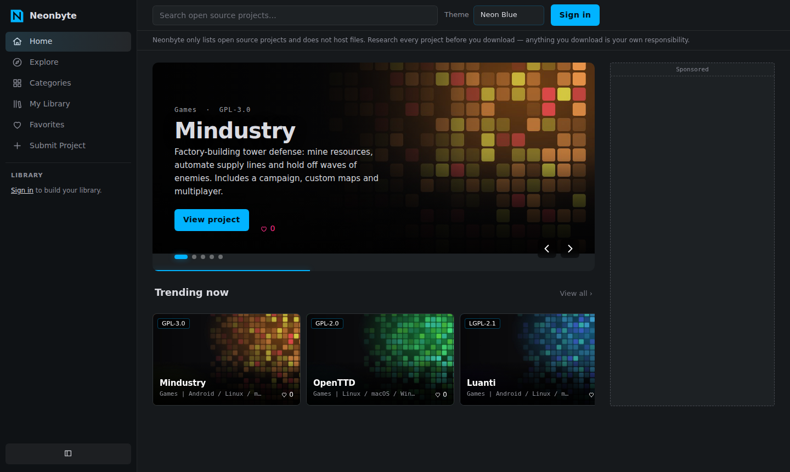
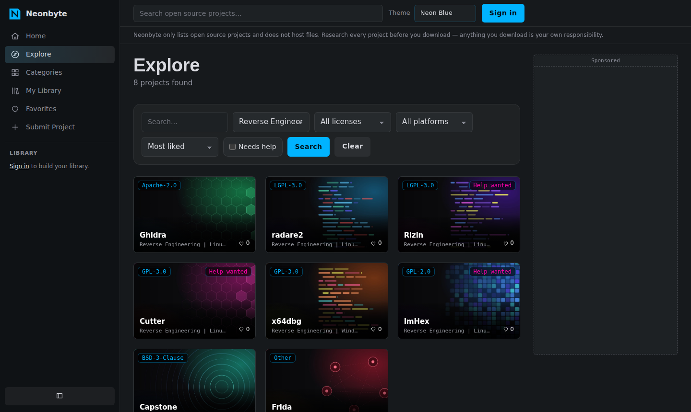

# Neonbyte

**A community library of open source software, with a focus on reverse engineering.**
Discover, share and follow projects such as disassemblers, debuggers, decompilers, hex editors and binary-analysis frameworks, plus open source games and everyday tools.

**Live site:** https://neonbyte.freehosting.dev · **License:** MIT · **Stack:** PHP 8 + MySQL/MariaDB + vanilla JS/CSS



## What is Neonbyte?

Neonbyte is a catalog where people post the open source projects they build or simply love, and where everyone else can find them. Each project gets a page with a description, license, platforms, screenshots, an optional video, and links to the **official** repository and download page.

It started as a library for newly released **reverse engineering (RE)** projects, because good RE tools are scattered across GitHub, GitLab and personal sites and are hard to follow. It also lists open source games and general software, so one place can answer "what is new and worth trying?".



### What it does not do

- **It never hosts or distributes software.** Download buttons point to the project's own official page. Visitors are told to research every project and that anything they download is their own responsibility.
- **It only lists open source projects.** No cracks, keygens, leaked code, DRM bypasses or malware. See the [content policy](docs/CONTENT_POLICY.md).

## Features

- Home page with a banner carousel of the most liked projects and rows such as *Trending*, *New releases* and *Needs contributors*
- Explore with search, filters (category, license, platform, "needs help") and sorting
- Categories, including **Reverse Engineering**, Games, Dev Tools, Multimedia, Security and Tools
- Project pages with screenshots (upload or link), video link, ratings and comments
- Likes, favorites and a personal library shown in the sidebar
- Notifications when someone likes or comments on your project
- Developer dashboard with views and download-link clicks
- Report button on every project, and an admin panel for projects, users and reports
- Five color themes (Neon Blue, Matrix Green, Synthwave, Amber Terminal, Blood Red), chosen by the visitor
- Reserved ad slots (no ad network is bundled), cookie consent banner, Terms, Privacy, Cookies and Content Removal pages
- Responsive layout with a collapsible sidebar; respects `prefers-reduced-motion`

## Privacy and security by design

Neonbyte is built so a stolen database dump reveals as little as possible about the people using it.

- **E-mails are encrypted** with AES-256-GCM. Login uses an HMAC-SHA256 "blind index", so addresses are never stored in readable form.
- **IP addresses are never stored.** Only HMAC hashes are kept, briefly, for login rate limiting.
- Passwords use `password_hash()` (bcrypt). Admin screens show only masked e-mails (`a***@e***.com`).
- Prepared statements everywhere, output escaping, CSRF tokens, strict session cookies, login rate limiting.
- Uploads are validated by MIME type and size, renamed, and served from a folder where script execution is disabled.
- Security headers and a Content-Security-Policy are set in `.htaccess`.
- **No secrets and no user data live in this repository.** Keys and database credentials come from `config.local.php` (git-ignored) or environment variables.

Details and a hardening checklist: [SECURITY.md](SECURITY.md).

## Quick start (local, XAMPP or any PHP host)

Requirements: PHP 8.1+ with `pdo_mysql`, `mbstring`, `openssl`, `fileinfo`; MySQL or MariaDB; Apache with `mod_headers` recommended.

```bash
git clone https://github.com/<your-user>/neonbyte.git
cd neonbyte

# 1. create the database and tables
mysql -u root -p < database/schema.sql

# 2. (optional) load a demo catalog: 27 real open source projects, no accounts
mysql -u root -p < database/demo_seed.sql

# 3. create your admin account (there is no default admin)
php tools/create_admin.php "Your Name" you@example.com
```

Serve the folder with Apache (for XAMPP, copy it to `htdocs/neonbyte`) or run `php -S localhost:8000`.
In development a random encryption key is generated automatically into `.dev-key` (git-ignored).

For production, see [docs/DEPLOYMENT.md](docs/DEPLOYMENT.md).

## Configuration

Set values in `config.local.php` (copy `config.local.example.php`) or as environment variables.

| Setting | Purpose |
|---|---|
| `APP_ENV` | `production` hides PHP errors and requires a real key |
| `SITE_URL` | Public URL of the site (auto-detected on localhost) |
| `DB_HOST`, `DB_NAME`, `DB_USER`, `DB_PASS` | Database connection |
| `NEONBYTE_KEY` | Base64 32-byte key for e-mail encryption. **Back it up, never commit it** |
| `CONTACT_EMAIL`, `LEGAL_EMAIL`, `PRIVACY_EMAIL`, `DMCA_EMAIL` | Addresses shown on the legal pages |

Generate a key with `php -r "echo base64_encode(random_bytes(32)), PHP_EOL;"`. To change it later use `tools/rotate_key.php`.

## Project layout

```
index.php, explore.php, project.php, ...   public pages
admin/        moderation panel (projects, users, reports)
api/          small JSON endpoints (like, favorite, report, click)
includes/     auth, crypto, db, layout, icons, uploads
assets/       css (style.css + hydra.css), js, icons, cover art
database/     schema.sql and optional demo_seed.sql
tools/        create_admin.php, rotate_key.php (CLI only)
docs/         content policy, deployment guide
```

## Known gaps and ideas

Not implemented yet: e-mail verification, password reset, two-factor login, named collections, GitHub/GitLab release integration, translations. Contributions are welcome, see [CONTRIBUTING.md](CONTRIBUTING.md).

## Disclaimer

Projects are submitted by the community. Neonbyte does not audit, host or endorse them. Always check the license and the source before downloading or running anything, especially binaries and tools that analyze or modify other software.

## License

[MIT](LICENSE). Project names, logos and screenshots shown on a listing belong to their respective owners.
